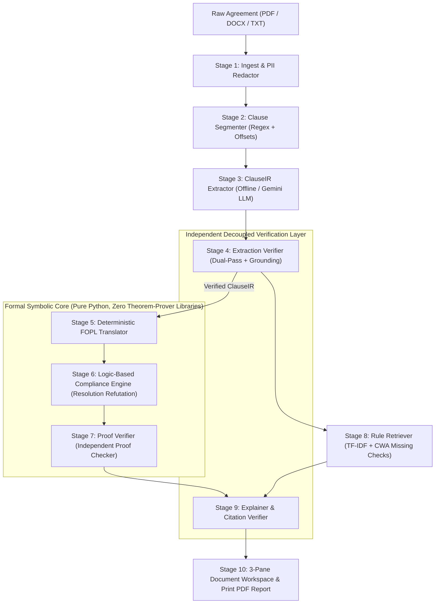

# ClauseLens

> **Residential Tenancy Compliance & Formal Verification Engine**  
> *Translates Indian rental agreements into plain English, flags unfair statutory risks, and mathematically proves internal contradictions using a pure First-Order Logic resolution refutation engine.*

[](https://www.python.org/downloads/)
[](https://react.dev/)
[](https://www.typescriptlang.org/)
[](https://opensource.org/licenses/MIT)
[]()
[-brightgreen.svg)]()

---

## 🏛️ 1. What is ClauseLens?

Every year, millions of tenants sign residential lease agreements containing hidden traps: **unrestricted landlord entry**, **excessive deposit forfeitures**, **unilateral rent escalation**, and **subtle cross-clause contradictions** where one clause gives a right that another secretly revokes.

Most tenants are not lawyers, and probabilistic LLMs are notorious for hallucinating legal authority or missing logical contradictions.

**ClauseLens** solves this through a strict hybrid architecture:
> **"LLMs read and explain; logic decides; independent verifiers check both."**

1. **Ingest & Redact**: Extracts text from PDFs, `.docx`, or raw text and automatically masks Indian Personally Identifiable Information (Aadhaar, PAN, phone, email).
2. **Segment & Extract**: Splits agreements into numbered clauses with character spans and extracts structured Intermediate Representations (`ClauseIR`).
3. **Formal Reasoning**: The **Logic-Based Contract Compliance Engine** translates contractual covenants into First-Order Predicate Logic (FOPL) and uses Robinson resolution refutation with procedural arithmetic to prove contradictions mathematically.
4. **Statutory Risk Assessment**: Evaluates clauses against vetted Indian tenancy provisions (Model Tenancy Act 2021, Transfer of Property Act 1882, Registration Act 1908).
5. **Decoupled Verification**: Independent dual-pass grounding checks and proof verifiers validate all claims before they can be badged as **Verified**.
6. **Negotiation Guidance**: Generates polite, advocate-drafted negotiation notes to send to landlords and answers What-If scenarios with formal proof links.

---

## 📐 2. Architecture & Pipeline



---

## 🎓 3. Academic Syllabus Alignment: "Logic-Based Contract Compliance Engine"

The formal reasoning core of ClauseLens is strictly titled **"Logic-Based Contract Compliance Engine"**, built from scratch in pure Python for AI/ML Course Module II (Knowledge Representation, Propositional & First-Order Predicate Logic, WFF to Clausal Form, Robinson Unification, Resolution Refutation):

| Syllabus Topic | ClauseLens Implementation Component | Location |
|---|---|---|
| **Knowledge Representation** | Deontic logic primitives `Obl(p, a)`, `Perm(p, a)`, `Forb(p, a)` with variable quantification | `backend/app/kb/axioms.fol` |
| **WFF Grammar & AST** | Lexer and recursive-descent parser for $\neg, \wedge, \vee, \rightarrow, \leftrightarrow, \forall, \exists$ | `backend/app/logic/lexer.py`<br>`backend/app/logic/parser.py` |
| **WFF to CNF (9 Discrete Steps)** | Step-by-step algebraic conversion: biconditionals $\to$ implications $\to$ NNF $\to$ standardize $\to$ Skolemize $\to$ drop $\forall$ $\to$ distribute $\vee$ over $\wedge$ $\to$ split $\to$ re-standardize | `backend/app/logic/cnf.py` |
| **Robinson Unification** | Robinson unification algorithm with occurs check and substitution composition | `backend/app/logic/unifier.py` |
| **Resolution Refutation** | Set-of-support strategy, unit preference, factoring, tautology deletion, subsumption, and minimal conflicting set extraction | `backend/app/logic/resolution.py` |
| **Procedural Arithmetic** | Ground numeric attachments: `LessThan(n, 90)`, `GreaterThan(x, y)`, `Equals(x, y)` evaluated during resolution | `backend/app/logic/ast.py` |
| **Decoupled Proof Verifier** | Independent verifier validating parent steps, polarities, unifiers, and empty clause $\square$ derivation without prover dependencies | `backend/app/logic/proof_checker.py` |

---

## 🔍 4. The Worked Contradiction Proof

A central demonstration of the engine is the contradiction between early termination rights:

- **Clause 3**: Perm(tenant, Terminate(30))  
  *(The tenant is permitted to terminate the tenancy with 30 days' notice)*
- **Clause 12**: $\forall n: (\text{LessThan}(n, 90) \rightarrow \text{Forb}(\text{tenant}, \text{Terminate}(n)))$  
  *(Early termination with less than 90 days' notice is strictly prohibited)*
- **Deontic Axiom**: $\forall p: \forall a: \neg(\text{Perm}(p, a) \wedge \text{Forb}(p, a))$  
  *(An action cannot be both permitted and forbidden for the same party)*

### Derivation Steps:
1. Clause 12 in CNF: $\neg\text{LessThan}(n, 90) \lor \text{Forb}(\text{tenant}, \text{Terminate}(n))$
2. Resolving Clause 12 with Axiom yields: $\neg\text{LessThan}(n, 90) \lor \neg\text{Perm}(\text{tenant}, \text{Terminate}(n))$
3. Unifying with Clause 3: substitution $\sigma = \{n \mapsto 30\}$
4. Procedural arithmetic evaluates `LessThan(30, 90)` $\to \text{True}$, so $\neg\text{LessThan}(30, 90) \to \text{False}$
5. Resolvent: $\square$ (**Empty Clause derived!**)
6. Minimal conflicting set extracted by backtracking proof leaves: **`['Clause_3', 'Clause_12']`**.

---

## 📊 5. Benchmark Evaluation & Verification

ClauseLens includes an automated evaluation harness (`backend/eval/run_eval.py`) that tests the entire pipeline across benchmark datasets and runs adversarial corruption attacks:

```text
$ python -m backend.eval.run_eval
======================================================================
CLAUSELENS SYSTEM EVALUATION HARNESS
======================================================================

Evaluating sample_a_fair.txt...
  Clauses: 7 (expected: 7)
  Conflicts: 0 (precision: 100.0%, recall: 100.0%)
  Rule Hits: [] (recall: 100.0%)
  Latency: 5.53 ms

Evaluating sample_b_problematic.txt...
  Clauses: 16 (expected: 16)
  Conflicts: 2 (precision: 100.0%, recall: 100.0%)
  Rule Hits: ['R01', 'R02', 'R03', 'R04', 'R05'] (recall: 100.0%)
  Latency: 13.1 ms

Evaluating sample_c_messy.txt...
  Clauses: 8 (expected: 8)
  Conflicts: 0 (precision: 100.0%, recall: 100.0%)
  Rule Hits: [] (recall: 100.0%)
  Latency: 2.88 ms

Running Adversarial Verifier Evaluation (5 Injected Corruptions)...
  [PASS] Corruption 1: Flipped Party (tenant -> landlord)
  [PASS] Corruption 2: Altered Notice Days (30 -> 999)
  [PASS] Corruption 3: Fabricated Statute Citation ('Indian Martian Tenancy Code 2099')
  [PASS] Corruption 4: Modified Evidence Quote (non-verbatim string)
  [PASS] Corruption 5: Inverted Modality (prohibition -> permission)
  Catch Rate: 5/5 (100.0%)

ALL EVALUATION TARGETS PASSED SUCCESSFULLY (100% Recall, 100% Verifier Catch Rate).
```

---

## 🚀 6. Quickstart Guide

### Prerequisites
- Python 3.11+
- Node.js v18+ (tested on Node v24)
- Git

### Installation
```bash
# 1. Clone the repository
git clone https://github.com/mai0372/aiml_ip.git clauselens
cd clauselens

# 2. Install backend dependencies
python -m pip install -r backend/requirements.txt

# 3. Install frontend dependencies
cd frontend && npm install && cd ..
```

### Running Tests
```bash
# Run all 16 backend unit & integration tests
python -m pytest backend/tests -v

# Run evaluation benchmark harness
python -m backend.eval.run_eval

# Run linter
python -m ruff check backend/

# Compile frontend TypeScript build
cd frontend && npm run build && cd ..
```

### Starting the Development Servers
```bash
# Terminal 1: Backend API (FastAPI)
python -m uvicorn backend.app.main:app --port 8000 --reload

# Terminal 2: Frontend (Vite + React)
cd frontend
npm run dev
```

Open **`http://localhost:5173`** in your browser.

---

## ⚙️ 7. Runtime Modes: Offline vs Gemini LLM

- **100% Offline Mode (Default, Zero Network)**:
  - If no `GEMINI_API_KEY` is set, ClauseLens operates in fully deterministic offline mode.
  - Extracts `ClauseIR` via regex patterns over the closed action ontology and runs the pure Python resolution theorem prover.
  - Complete end-to-end audit executes in **~14 milliseconds on standard CPU**.
- **Gemini LLM Provider (Optional)**:
  - Set `GEMINI_API_KEY` and `LLM_PROVIDER=gemini` in `.env`.
  - The LLM extracts unstructured nuances into `ClauseIR`, but **never decides logic or conflicts**.
  - All extracted terms are independently cross-checked by the decoupled verification layer.

---

## 📜 8. Indian Tenancy Seed Rule Pack (R01–R10)

ClauseLens seeds its statutory analysis with 10 rules grounded in Indian rental jurisprudence:
- **R01**: Security deposit exceeds 2 months' rent (*Model Tenancy Act 2021, Section 11(1)*)
- **R02**: Landlord entry without 24 hours prior written notice (*Model Tenancy Act 2021, Section 15(1)*)
- **R03**: Rent revision without 3 months' prior written notice (*Model Tenancy Act 2021, Section 9(1)*)
- **R04**: Disconnection of essential utilities (water/power) as remedy (*Model Tenancy Act 2021, Section 20*)
- **R05**: Total forfeiture of security deposit without itemized repair accounting (*Indian Contract Act 1872, Section 74*)
- **R06**: Asymmetric termination notice periods favoring the landlord (*Model Tenancy Act 2021 & Principles of Natural Justice*)
- **R07**: Lease term exceeding 11 months without registration clause (*Registration Act 1908, Section 17(1)(d)*)
- **R08**: Termination notice period shorter than statutory 15 days (*Transfer of Property Act 1882, Section 106*)
- **R09**: Oppressive lock-in period penalty (*Indian Contract Act 1872, Section 74*)
- **R10**: Closed-World Assumption (CWA) missing vital tenant protections (*Deposit return timeline, structural repair division*)

*Note: All rules are unreviewed (`reviewed: false`) until certified by an advocate. ClauseLens displays verified government India Code and MoHUA source links.*

---

## ⚠️ 9. Honest Limitations & Disclaimers

1. **Not Legal Advice**: ClauseLens is an educational and decision-support audit tool. It does not establish an attorney-client relationship.
2. **Semi-Decidable Logic**: First-order predicate logic resolution is semi-decidable. Outcomes are tri-state: `REFUTATION_FOUND`, `SATURATED_NO_REFUTATION` (within search bounds), or `UNKNOWN_BUDGET_EXHAUSTED`. ClauseLens never falsely claims a contract is "guaranteed compliant".
3. **No OCR**: Uploaded PDFs must contain readable text streams. Scanned image PDFs must be converted using OCR prior to ingestion.
4. **State Tenancy Variations**: While the Model Tenancy Act 2021 provides central guidance, tenancy laws in India vary by state adoption (e.g., Karnataka Rent Act, Maharashtra Rent Control Act, Delhi Rent Control Act).

---

## 📁 10. Repository Structure

```
clauselens/
├── backend/
│   ├── app/
│   │   ├── agents/            # 10-stage pipeline orchestrator, extractors, and explainer
│   │   │   ├── verifiers/     # Decoupled Extraction and Explanation Verifiers
│   │   ├── api/               # FastAPI REST router & SSE stream endpoints
│   │   ├── db/                # SQLModel SQLite database & session models
│   │   ├── kb/                # Domain axioms (axioms.fol) and Indian rule pack (YAML)
│   │   ├── logic/             # "Logic-Based Contract Compliance Engine" (Module II)
│   │   │   ├── ast.py         # Terms, Predicates, Clauses, WFF nodes, Procedural Arithmetic
│   │   │   ├── lexer.py       # Logic lexer with coordinate tracking
│   │   │   ├── parser.py      # Recursive-descent WFF parser
│   │   │   ├── cnf.py         # 9-step WFF to CNF transformation engine
│   │   │   ├── unifier.py     # Robinson Unification with occurs check
│   │   │   ├── resolution.py  # Resolution refutation theorem prover
│   │   │   └── proof_checker.py # Independent Decoupled Proof Verifier
│   │   ├── models/            # Pydantic v2 ClauseIR, Findings, and API schemas
│   │   └── main.py            # FastAPI application entrypoint
│   ├── eval/                  # run_eval.py evaluation harness & benchmark runner
│   ├── tests/                 # 16 pytest tests (logic engine, pipeline, API)
│   └── requirements.txt       # Pinned backend dependencies
├── docs/
│   ├── ARCHITECTURE.md        # Architectural flow and design principles
│   ├── DECISIONS.md           # Engineering decision records (ADRs)
│   ├── SOURCES.md             # Primary Indian legal statutory citations
│   ├── EVAL_RESULTS.md        # Real benchmark evaluation results
│   └── VERIFICATION_REPORT.md # Final acceptance testing sign-off report
├── frontend/
│   ├── src/
│   │   ├── components/        # ClauseNavigator, DocumentReader, InspectorPane, ProofTree
│   │   ├── pages/             # AnalysisWorkspace, LogicLab, Rulebook, History
│   │   ├── lib/               # Typed API client, utility helpers
│   │   └── types/             # TypeScript interfaces matching backend models
│   ├── index.html             # Google fonts typography and web shell
│   └── package.json           # React 18, Vite, Tailwind CSS, Lucide icons
├── samples/                   # Sample agreements A (Fair), B (Planted), C (Messy) + Ground Truth
├── Makefile                   # make dev, make test, make eval, make lint, make build
├── pyproject.toml             # Ruff and Pytest project configuration
└── README.md                  # Comprehensive product & technical documentation
```

---

## 📄 License & Credits

Developed for the AI/ML Formal Methods & Contract Compliance Initiative.  
Distributed under the MIT License.
