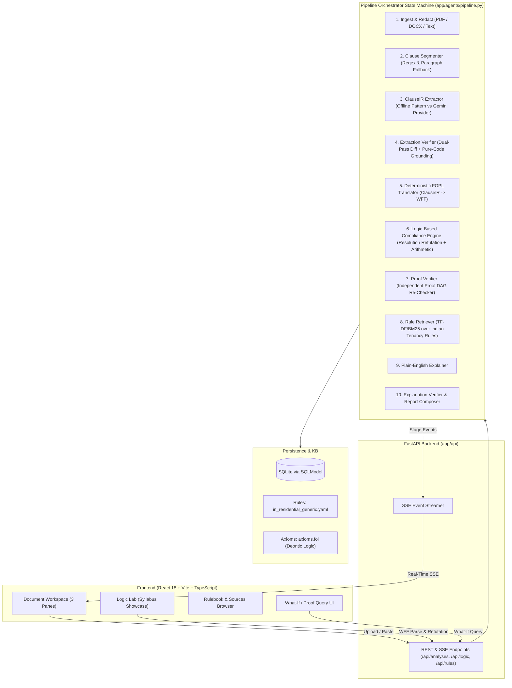
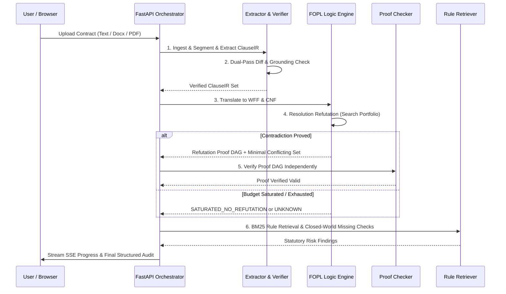

# ClauseLens Architecture

ClauseLens is a high-assurance legal intelligence platform designed to help tenants and housing advisors thoroughly evaluate residential rental agreements before signing. It pairs LLM-assisted comprehension with a formal First-Order Logic (FOPL) resolution refutation engine, coupled with independent multi-stage verification layers.

## Core Architectural Principle
> **LLMs read and explain; logic decides; independent verifiers check both.**
> The LLM never writes raw formal logic and never decides whether a contradiction or violation exists. Formal inference is performed exclusively by the pure-Python **Logic-Based Contract Compliance Engine**.

---

## 1. System Topology

---

## 2. The 10-Stage Pipeline Lifecycle

Each stage runs as an isolated step in `backend/app/agents/pipeline.py` and emits standard SSE events:
`{ "stage": str, "status": "running"|"completed"|"failed", "duration_ms": int, "detail": str }`.

### Stage 1: Ingest & Normalization (`ingest.py`)
- Accepts UTF-8 text, `.docx` (via `python-docx`), and text `.pdf` (via `pdfplumber`).
- Normalizes unicode quotation marks, en/em dashes, non-breaking spaces, and whitespace.
- Optional PII redaction (configurable in settings or request): masks Indian mobile numbers (+91/10-digit), email addresses, Aadhaar-like 12-digit IDs, and PAN card numbers before sending to external services.

### Stage 2: Clause Segmenter (`segmenter.py`)
- Splits legal agreements into discrete clause objects.
- Uses hierarchical regex for Indian legal drafting patterns:
  - Roman numerals (`I.`, `II.`, `III.`)
  - Numeric clauses (`1.`, `1.1`, `Clause 4`)
  - Sub-clauses (`(a)`, `(b)`, `(i)`, `(ii)`)
  - Fallback: Double-newline paragraph splitting.
- Preserves absolute `[start, end]` character offsets into the original text for verbatim highlighting in the UI.

### Stage 3: Extractor (`extractor.py`)
- Extracts a structured `ClauseIR` object for each segment.
- Operates in two interchangeable modes:
  - **Offline Mode (Default)**: Deterministic regex and lexical pattern matchers mapping keywords against the closed action ontology. Requires zero network, zero API key, runs instantaneously.
  - **LLM Mode (Optional)**: Invokes Gemini API via `google-genai` SDK with structured Pydantic schema validation. Produces `evidence_quote` first, internal reasoning, and structured fields.
- **Fixed Action Ontology**:
  - `PayRent`, `PayDeposit`, `RefundDeposit`, `EnterPremises`, `Terminate(notice_days)`, `IncreaseRent(notice_days, percent)`, `Sublet`, `Repair`, `CutUtilities`, `ForfeitDeposit(amount_or_ratio)`, `ChargeLateFee(percent)`, `Renew`, `Evict`, `Other`.

### Stage 4: Extraction Verifier (`verifiers/extraction_verifier.py`)
- Runs decoupled from the extractor:
  1. **Dual-Pass Extraction**: Runs a secondary independent extraction (alternative pattern-set in offline mode; different prompt/temperature in LLM mode). Computes deterministic diffs over `(party, modality, action, params)`. Discrepancies mark findings as `needs_review`.
  2. **Grounding Check (Pure Code)**: Verifies that every extracted number, party, and action parameter exists literally inside the clause text. Ungrounded hallucinations are stripped immediately.
  3. **Schema & Ontology Validation**: Strict Pydantic boundary assertion.

### Stage 5: Deterministic FOPL Translator (`translator.py`)
- Converts `ClauseIR` into First-Order Predicate Logic WFFs.
- Purely algorithmic; contains zero LLM calls.
- Encodes modalities into deontic predicates:
  - Obligation $\to \text{Obl}(\text{party}, \text{action})$
  - Permission $\to \text{Perm}(\text{party}, \text{action})$
  - Prohibition $\to \text{Forb}(\text{party}, \text{action})$
- Attaches clause provenance tags to every generated formula.

### Stage 6: The Logic-Based Contract Compliance Engine (`backend/app/logic/`)
- Formal theorem prover built from scratch in pure Python (AI/ML Module II specification):
  - **Lexer & Recursive-Descent Parser**: Handles quantifiers ($\forall, \exists$), connectives ($\neg, \land, \lor, \to, \leftrightarrow$), predicates, functions, and terms.
  - **9-Step CNF Converter**: Converts WFF to Clausal Normal Form with full step recording for UI replay.
  - **Robinson Unification**: Implements unification with the occurs check and substitution composition.
  - **Resolution Refutation Engine**:
    - Strategy portfolio: Unit preference, Set-of-Support (SoS), and BFS.
    - Factoring, tautology elimination, and subsumption.
    - **Procedural Attachment for Arithmetic**: Evaluates `LessThan`, `GreaterThan`, and `Equals` on ground numbers during resolution.
    - Search guards: Max clause budget, term depth limits, wall-clock timeout.
    - **Tri-State Semantics**: `REFUTATION_FOUND`, `SATURATED_NO_REFUTATION`, `UNKNOWN_BUDGET_EXHAUSTED`.
    - Minimal conflicting clause set extraction by walking back from the empty clause $\Box$.

### Stage 7: Proof Verifier (`logic/proof_checker.py`)
- Independent verification pass.
- Re-checks every proof step without using the prover's internal code:
  - Verifies that resolvent literals accurately derive from the two parent clauses under the recorded unifier $\theta$.
  - Asserts factoring validity and procedural arithmetic reductions.
  - Verifies that the final derivation is indeed the empty clause $\Box$.
  - Verifies that all leaves belong to the initial input formula set.

### Stage 8: Rule Retriever & Risk Assessor (`kb/retriever.py`)
- Evaluates contracts against the Indian Residential Tenancy Rule Pack (`in_residential_generic.yaml`).
- Uses TF-IDF / BM25 lexical retrieval to locate applicable statutory rules (e.g. Model Tenancy Act deposit caps, 24-hour notice of entry, utilities protection).
- Runs Closed-World Assumption (CWA) checks for missing vital protections (e.g., missing deposit refund timeline or structural repair allocation).

### Stage 9: Explainer (`explainer.py`)
- Generates plain-language explanations of identified risks, contradictions, and missing protections.
- Template-based generator with slot-filling guarantees; optional LLM polish strictly constrained to extracted facts.

### Stage 10: Explanation Verifier & Report Composer (`verifiers/explanation_verifier.py`)
- Independent explanation verifier:
  - Verifies that all cited clause numbers actually exist in the contract.
  - Checks that quotes in the explanation match the contract text verbatim.
  - Asserts that legal risk findings are marked "Verified" only if their governing rule has a valid `source_url` and verified statutory citation.
- Assembles the finalized structured audit payload and saves it to the SQLite history database.

---

## 3. Data Flow & Provenance Model

---

## 4. UI Layer Architecture

The frontend is built with React 18, Vite, TypeScript (strict), and Tailwind CSS:
- **Theme Engine**: Light and dark mode support via CSS variables, defaulting to system preference with zero flash.
- **Document Reading View**: Custom serif typography with responsive color-coded gutters and inline span highlights linked to findings.
- **Three-Pane Workspace**:
  - Pane 1: Clause Navigator with severity indicators and search filter.
  - Pane 2: Highlighting Document Viewer with interactive hover cards.
  - Pane 3: Tabbed Intelligence Panel (Summary, Findings with Statutory Source cards, Ask/What-If proof queries, Timeline, and Logic Proof Stepper).
- **Logic Lab Route (`/logic-lab`)**:
  - Academic syllabus showcase enabling custom WFF input, AST inspection, 9-step CNF step-through, and animated resolution tree player.
- **Rulebook & Sources Route (`/rules`, `/sources`)**:
  - Transparent catalog of Indian tenancy laws, review statuses, and official India Code links.
